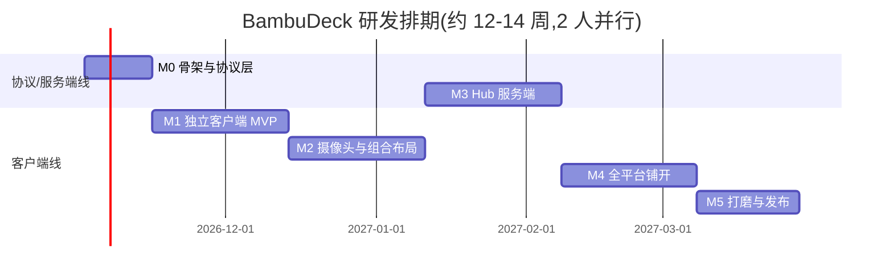

# BambuDeck 研发计划

- 版本:v0.1(草案)
- 日期:2026-10-15
- 关联文档:[需求文档(PRD)](需求文档-PRD.md)

---

## 1. 技术选型

### 1.1 客户端框架:Flutter(结论)

候选对比(面向 Win/mac/Linux/Android/iOS 五端 + 重度自绘 UI + 视频播放):

| 方案 | 五端覆盖 | 自绘仪表/大屏 UI | 视频/RTSP 生态 | 代码共享 | 结论 |
|---|---|---|---|---|---|
| **Flutter** | ✅ 五端 stable(2022 年起桌面稳定) | ✅ Skia/Impeller 自绘,仪表/辉光/卡片类 UI 最强 | ✅ media_kit(libmpv)五端,`easy_onvif`、`mqtt_client` 齐备 | ✅ Dart 全栈 | **选定** |
| React Native | ❌ Linux/Windows 弱 | ⚠️ 依赖 WebView/原生桥 | ⚠️ VLC 桥接为主 | JS 生态 | 否 |
| Tauri v2 | ✅ 桌面强 + 移动端较新 | ⚠️ WebView 方案,复杂动画一致性差 | ⚠️ 依赖前端播放器 | 前端+Rust | 否(移动端成熟度不足) |
| Kotlin Multiplatform | ✅(Compose Multiplatform) | ✅ 尚可 | ⚠️ 需自行封装 ffmpeg | Kotlin | 否(iOS/桌面组件成熟度与工期风险) |

**选型依据**:① Flutter 桌面自 2022 年 stable,仪表盘/卡片/辉光这类原项目 UI 语义(34 种仪表、边缘辉光、多皮肤)用 CustomPainter 移植成本最低;② media_kit 是 Flutter 生态唯一成熟五端播放器(libmpv,支持 4K/60fps、硬解、RTSP);③ Dart 服务端(shelf)可与客户端共享协议/模型代码,服务端+客户端模式开发效率翻倍;④ 风险点(iOS RTSP 延迟、Flutter Web 无 RTSP)已在 PRD 4.3.2 给出缓解路径。

### 1.2 关键依赖清单

| 领域 | 依赖 | 用途 |
|---|---|---|
| 状态管理 | `riverpod` | 全局状态/依赖注入 |
| MQTT | `mqtt_client` | 打印机局域网/云连接(TLS、WebSocket) |
| 模型序列化 | `freezed` + `json_serializable` | 打印机/AMS/HMS 状态模型(对应原 `bambu_state.h`) |
| 视频 | `media_kit` + `media_kit_video` + `fvp` | RTSP/RTSPS/MJPEG/HLS/WebRTC(Hub 出口)播放 |
| 摄像头协议 | `easy_onvif` | ONVIF 发现/取流/PTZ |
| 安全存储 | `flutter_secure_storage` | 凭据五端安全存储 |
| 本地持久化 | `isar` 或 `shared_prefs`(轻配置)+ `hive`(布局方案/功耗历史) | 设置与数据 |
| 网络 | `dio` | 插座 HTTP(Tasmota/Shelly)、萤石云 API |
| 服务发现 | `bonsoir`(mDNS)+ SSDP 自实现(dart udp) | 打印机/ONVIF 设备发现 |
| 推送(经 Hub) | `ntfy` 客户端(HTTP/WS,自建免审核) | Android/iOS 离线推送 P1 |
| Hub 服务端 | `shelf`/`dart_frog` + `web_socket_channel` + 内嵌 go2rtc sidecar | 模式 B 服务端 |
| WebRTC(Hub 出口) | go2rtc 信令 + `flutter_webrtc` | 亚秒延迟视频 |

### 1.3 服务端技术:与客户端同栈(Dart)

Hub 用 Dart(shelf/dart_frog)而非 Go/Rust 的理由:**打印机 MQTT 协议解析、状态模型、Bambu 云登录、插座协议这四块核心逻辑在 client/hub/server 三个包里原样共享**,一份代码三处使用;Hub 的重活(视频)本来就外包给 go2rtc sidecar,Dart 做 API/鉴权/聚合编排完全够用。若后期 Hub 需要更高并发再局部下沉,不影响客户端。

### 1.4 从原项目移植什么、放弃什么

| 原项目资产 | 处置 |
|---|---|
| MQTT 连接管理(LAN/Cloud 双模式、pushall 恢复、指数退避、12 种重推原因) | **移植**(逻辑直译 Dart,`bambu_mqtt.cpp` ≈3000 行作规格) |
| Bambu 云登录(密码/邮箱码/2FA/token,续期) | **移植**(`cloud_login.cpp` 为规格) |
| 状态模型 `bambu_state.h` 全字段 | **移植**为 freezed 模型 |
| HMS 错误句表(2675 行)+ 严重度/基线抑制规则 | **移植**为打包数据文件(JSON) |
| 插座协议 ×4(Tasmota/Shelly Gen2/3/4/Kasa) | **移植**(HTTP 逻辑简单直译) |
| P1/A1 相机 MJPEG 客户端(`camera_client.cpp`) | **移植**(media_kit 不直接吃该流,需自写 TLS MJPEG 解帧 → 图像序列渲染) |
| SSDP 发现 | **移植** |
| 腔灯/控制命令格式 | **扩展**(原项目仅腔灯;新增暂停/恢复/停止按 OpenBambuAPI) |
| LovyanGFX 渲染、布局几何、NVS、触摸/蜂鸣器/LED/电池驱动 | **不移植**(硬件层;UI 语义即 PRD FR-4) |
| Web 门户 40+ 端点 | **参考**(Hub REST API 设计蓝本) |

---

## 2. 仓库结构(monorepo)

```
BambuDeck/
├─ apps/
│  ├─ deck/            # Flutter App(五端一个 target,平台条件编译)
│  └─ hub/             # Dart shelf 服务端 + Docker 打包
├─ packages/
│  ├─ bambu_protocol/  # 拓竹 MQTT/云登录/模型/HMS 表(共享核心)
│  ├─ plug_protocol/   # Tasmota/Shelly/Kasa 插座协议
│  ├─ camera_core/     # ONVIF 客户端、RTSP 地址管理、MJPEG 解帧
│  ├─ deck_ui/         # 仪表/卡片/辉光组件库(CustomPainter 移植)
│  └─ deck_models/     # 配置/布局方案 schema(client & hub 共享)
├─ docs/               # 本文档与 PRD、ADR 决策记录
├─ tools/              # HMS 表转换脚本(吃原项目 error_tables 生成 JSON)
└─ .github/workflows/  # 五端 CI 构建
```

原则:原项目代码**只读参考**,移植进 `packages/` 时重写为 Dart,不复制 C++ 文件;HMS 句表作为数据文件从原项目 `include/error_tables/` 生成转换。

---

## 3. 里程碑规划

总节奏:6 个里程碑,单人全职约 21 周;2 人小团队(一人端内 UI/交互、一人协议/服务端)并行约 12–14 周。以下按 2 人并行口径估时。

### M0 — 骨架与协议层(2 周)

- monorepo 搭建(Flutter + melos/workspaces)、CI 骨架(单元测试 + lint);
- `bambu_protocol`:MQTT LAN/Cloud 连接、状态解析(freezed 模型)、pushall 恢复、指数退避;
- HMS 句表转换脚本 + 打包数据文件;
- 用一台真打印机 + 一台模拟器(本地 mosquitto 回放报文)做协议级单测。
**验收**:Dart 命令行 demo 实时打印任一台拓竹打印机全量状态,断线自动恢复。

### M1 — 独立客户端 MVP(4 周,Windows + Android 优先)

- App 骨架:riverpod 状态、路由、深色主题(继承原项目配色 token);
- 打印机管理:添加(局域网 IP+访问码 / 云登录三方式)、多打印机列表、智能轮换;
- 监控页 v1:桌面仪表卡片(进度弧/温度/AMS/HMS 徽标,`deck_ui` 移植 6 种核心仪表)、手机详情页;
- 打印机控制:暂停/恢复/停止/腔灯(带确认);
- 系统通知(完成/失败/HMS);
- 凭据安全存储接入。
**验收**:PRD AC-1、AC-2、AC-5(通知部分)在 Windows 与 Android 通过。

### M2 — 摄像头与组合布局(4 周)

- `camera_core`:RTSP/RTSPS 地址管理、ONVIF 发现与 PTZ(easy_onvif)、拓竹自带相机(RTSPS + P1/A1 MJPEG 解帧)、萤石/小米接入引导向导(按 PRD 4.3.1 矩阵分发不同指引);
- 播放:media_kit + fvp,低延迟参数调优,截图、断流占位与重连、视口外停拉;
- **组合布局 v1**:预设模板网格(1+1 / 2+2 / 4+4),打印机卡片 + 视频块混排,大屏/手机自适应;
- kiosk 全屏 + 布局方案保存/切换。
**验收**:PRD AC-3、AC-4(30 分钟 4 路混播)、AC-8(布局 JSON 跨端渲染,iOS 延后到 M4)。

### M3 — Hub 服务端(4 周,与 M2 尾部并行)

- `apps/hub`:打印机/摄像头/插座上游聚合,WebSocket 状态与控制 API;
- go2rtc sidecar 集成:RTSP 输入 → WebRTC/HLS 输出,信令对接 App(flutter_webrtc);
- 鉴权(用户名密码 + token + TLS)、多客户端会话;
- ntfy 推送对接(打印完成/失败/HMS/断电事件);
- Web 管理页(配置打印机/摄像头/用户);
- Docker 镜像(amd64/arm64)。
**验收**:PRD AC-6(NAS 级硬件可后测,先用台式机口径)。

### M4 — 全平台铺开(4 周)

- macOS(universal dmg)、Linux(AppImage/deb)、iOS(TestFlight);
- iOS 视频专项:media_kit 延迟调优 → 不达标则 iOS 走 Hub WebRTC 主路径(PRD 4.3.2 已定);
- 功耗 FR-5 全量(Tasmota/Shelly×3/Kasa + 打印电量统计 + 自动断电热端闸门)+ 功耗曲线;
- Android 常驻通知栏进度、App 内提示音;
- 局域网发现(SSDP/mDNS)。
**验收**:PRD AC-5 完整版、AC-7;五端全部可跑同一功能面。

### M5 — 打磨与发布(3 周)

- 布局编辑器自由模式(拖拽/跨度调整)、布局方案导入导出、轮播;
- i18n 收尾(zh-CN/en 全量,含 HMS 双语)、高对比与大字号模式;
- 压测与长稳(kiosk 72h)、内存泄漏排查;
- 打包分发:Windows installer + portable、五端产物 CI 化;文档(部署手册:Hub 安装、摄像头开通指引、拓竹局域网/开发者模式指引与已知固件坑);
- v1.0 发布(GitHub Releases + 文档站)。
**验收**:PRD 全部 AC 复核;发布检查单通过。

### 甘特图(2 人并行口径)



> 说明:M3 在 M2 启动 2 周后由协议线人力切入,与 M2 尾部并行,总周期压缩至约 14 周;若单人执行,按 M0→M1→M2→M3→M4→M5 串行,约 21 周。

---

## 4. 测试策略

| 层次 | 手段 |
|---|---|
| 协议单测 | 本地 mosquitto 回放录制报文(脱敏),覆盖全状态字段解析、异常报文、token 续期、pushall 恢复矩阵 |
| 模型单测 | `bambu_state` 对齐原项目字段口径(逐字段快照对照) |
| 摄像头集成 | 本地 docker 起 go2rtc + 一台公网/局域网真机摄像头;ONVIF 用容器模拟器 + 真机双重验证 |
| UI 黄金测试 | `deck_ui` 仪表组件截图对照(与原项目屏幕截图比对视觉语义) |
| 长稳 | kiosk 模式 72h(4 路 1080p + 4 打印机),内存/CPU 曲线无爬升 |
| 真机矩阵 | Windows 11 桌面、macOS(Apple Silicon + Intel 各一)、Ubuntu LTS、Android 8/12/14 各一、iOS 14/17 各一 |
| Hub 并发 | 3 客户端 × 4 打印机 × 2 摄像头场景脚本化压测 |

---

## 5. CI/CD 与分发

- GitHub Actions 矩阵:Windows / macOS / Ubuntu 三 runner 构建 Flutter 桌面与 Hub;Android 用 ubuntu runner;iOS 用 macOS runner;
- 产物:Windows(exe installer + zip portable)、macOS(dmg,universal)、Linux(AppImage/deb)、Android(apk,后续 aab)、iOS(TestFlight 通道)、Hub(三平台二进制 + 多架构 Docker 镜像);
- 版本策略:与原项目版本号脱钩,独立 v0.x → v1.0;tag 触发发布;
- 代码签名:首发阶段 Windows/macOS 允许未签名 + 文档说明(SmartScreen/Gatekeeper 提示),签名证书列入后续预算项;iOS 免费开发者账号走 TestFlight 需付费账号($99/年),P1 决策项。

---

## 6. 风险清单与缓解

| # | 风险 | 等级 | 缓解 |
|---|---|---|---|
| R1 | 拓竹固件升级收紧局域网/开发者模式(2025 年 P 系 1.08 曾破坏) | 高 | 云模式为内建降级路径;跟踪 OpenBambuAPI/HA 社区;PRD 7.1 明示不承诺固件对抗 |
| R2 | iOS 上 media_kit RTSP 落后直播数十秒 | 高 | 三层缓解:mpv 低延迟参数 → Hub WebRTC 主路径(iOS 推荐)→ flutter_vlc_player A/B 备选 |
| R3 | 小米老型号无 RTSP,Micam 桥接随米家固件失效 | 中 | 产品定位为"指引 + 兜底 RTSP";萤石同理推荐局域网 RTSP 而非云 API |
| R4 | 萤石开放平台云 API 频控/收费策略变化 | 中 | 局域网 RTSP 为推荐主路径,云 API 仅作补充功能 |
| R5 | 多路 1080p 软解导致低端设备卡顿 | 中 | 强制硬解探测、视口外停拉、子码流默认、超 4 路降帧 |
| R6 | Flutter 桌面个别插件缺口(托盘/自启/系统通知差异) | 中 | 优先社区维护包(tray_manager、launch_at_startup、local_notifier),缺口用 platform channel 自补 |
| R7 | go2rtc 作为外部 sidecar 的打包与升级复杂度 | 中 | Hub 首版可"内嵌二进制"发布,Docker 场景直接双容器;接口隔离以便日后替换 |
| R8 | HMS 句表授权口径 | 低 | 句表源自社区整理(与原项目同源),随包分发并注明来源;仅作为数据不作为服务 |
| R9 | 单人多里程碑工期膨胀 | 中 | M1 只做 Windows+Android 双端先行;Web 端、录像回放、HomeKit 等全部锁在 P2 之外 |

---

## 7. 资源与协作建议

- **人力**:最小可行配置 2 人(客户端 UI ×1、协议/服务端 ×1);单人可交付,周期约 21 周;
- **硬件准备**:至少 1 台拓竹打印机(局域网 + 云双模式验证)、1 台萤石 + 1 台小米摄像头、1 台 ONVIF 摄像头(海康/TP-Link 均可)、1 台常驻 Linux 设备(Hub,NAS/迷你主机);
- **账号**:Bambu 测试账号、萤石开放平台开发者账号(AppKey)、Apple Developer(决定是否上 TestFlight)、ntfy 自建实例;
- **决策记录**:技术选型、iOS 视频路径、Hub 鉴权方案等以 ADR 文档落在 `docs/adr/`,与两份主文档联动。

---

## 8. 近期行动清单(本周可启动)

1. 确认项目名(BambuDeck 为占位)与仓库初始化(monorepo 骨架 + CI);
2. 采购/征用测试硬件(第 7 节清单);
3. 跑通 M0 验收口径:Dart 连一台真打印机,终端打印全量状态;
4. 落地第一个 ADR:客户端框架选型 Flutter(引用本文 1.1)与 iOS 视频主路径(R2 缓解层);
5. 将原项目 `include/error_tables/` 接入 HMS JSON 转换脚本,验证句表完整性。
